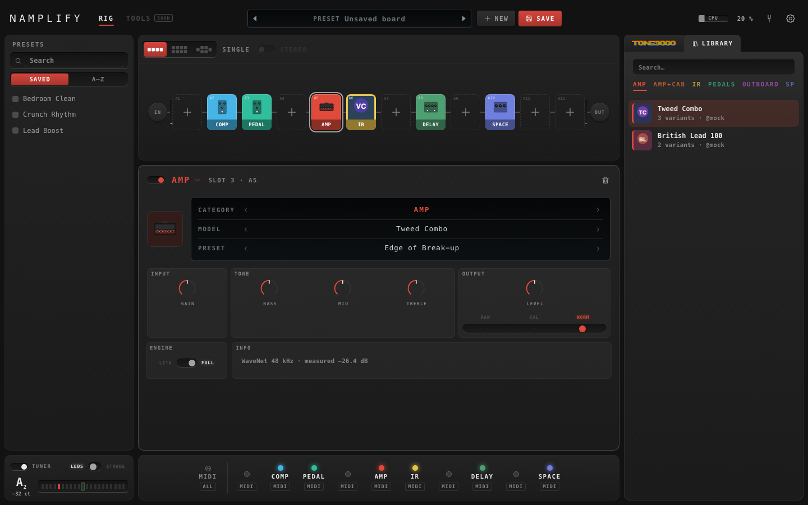
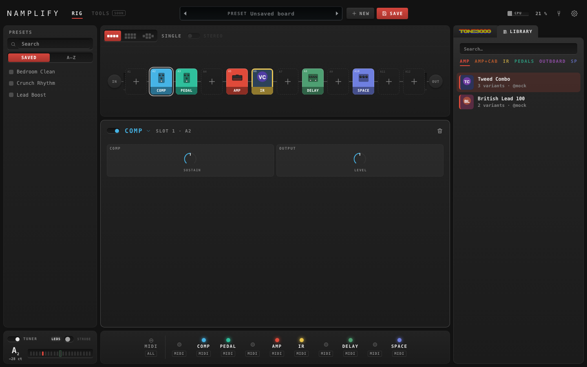
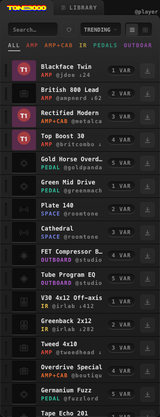
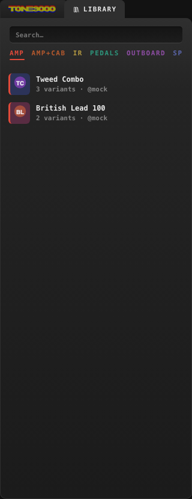
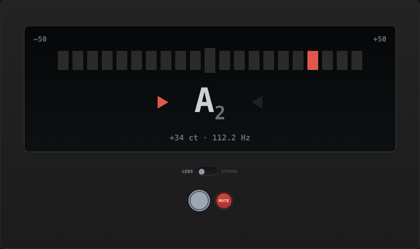
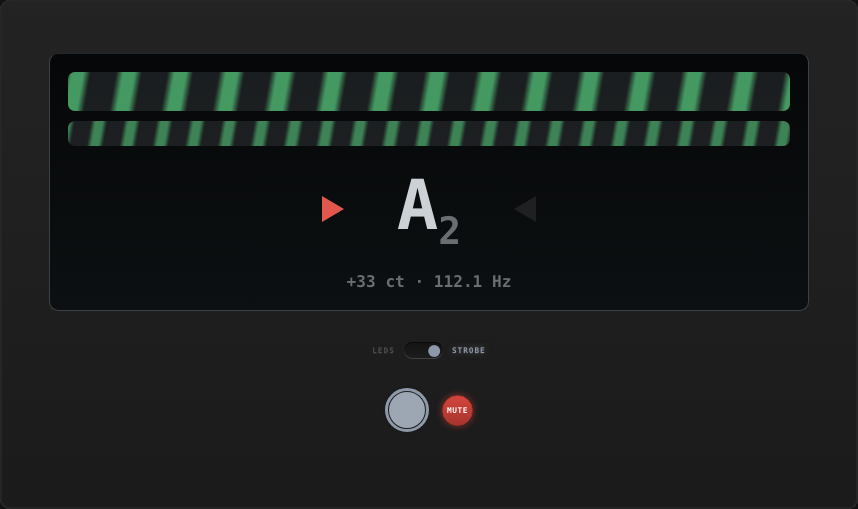
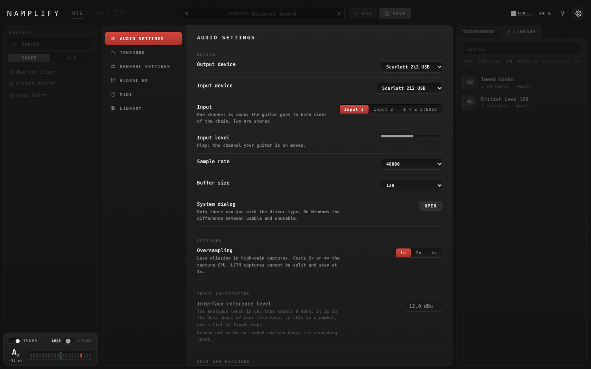

# NAMplify

**NAM, made simple.**

## Amplify the NAM. Simplify the rest.

NAMplify amplifies NAM captures and simplifies everything that normally stands
between you and them. Loading them is the easy part. Plenty of things do that.
This is about the half hour after.

Shove pedals around until the chain sits right. Flip through a whole bank of amps
without stopping playing. Split the signal into two lanes and hear both amps at once.

Click a capture in the [TONE3000](https://www.tone3000.com) browser and you're
hearing it. Nothing to import, no folder to dig through, no guessing which slot
it goes in. It's automatic, and it makes sense the first time.

It's a free pedalboard for macOS, Windows and Linux, as a standalone app and as a
plugin, built for picking the guitar up for twenty minutes. Not for running a session.

**[⬇ Download the latest release](https://github.com/Roccccky/NAMplify/releases)**: macOS 11+ · Windows 10/11 · Linux, standalone · VST3 · AU

*Version 2 is a rebuild from the engine up and an early beta. It's played most on macOS with an
audio interface; the Windows and Linux builds come from CI and have seen less playing time.*

---

<table>
<tr>
<td width="50%" valign="top">

 <b>Twelve cells, one chain.</b> NAM captures, IRs and effects wherever you like. Click a slot for its card.
</td>
<td width="50%" valign="top">

 <b>TONE3000 and your library, inside the app.</b> Two index cards right next to the chain.
</td>
</tr>
<tr>
<td width="50%" valign="top">

 <b>A tuner that's always on.</b> In the corner as an LED row, full size with one click.
</td>
<td width="50%" valign="top">

 <b>Or as a strobe.</b> The bands stand still when the string is in tune.
</td>
</tr>
</table>

**And everything else in one place.** Audio device and input level, global EQ, MIDI, oversampling
and where the library lives.

## What's on the board

**NAM slots know what they hold.** `PEDAL` for overdrives, fuzzes and boosts in front of the amp.
`AMP` for amp captures, `AMP + CAB` for full rigs. `OUTBOARD` for preamps and studio gear,
`SPACE` for rooms. Each slot has its own NAM engine, `FULL` or `LITE`.

**IRs for the cab.** Load an amp without one and NAMplify brings a cab along.

**Around them, a normal board.** Gate, compressor, drive, EQ, chorus, flanger, phaser, tremolo,
delay and reverb, in any cell. Click a slot for its card, drag it somewhere else.

**One lane, two lanes or a split.** Twelve cells in a row, two lanes side by side, or a split with
a common head and tail.

**TONE3000, inside the app.** Browse and search TONE3000 right next to the chain, sorted into amps,
amps with cab, IRs, pedals, outboard and spaces. Click a capture and you hear it: it goes into a slot
of its own, marked `PREVIEW`, until you keep it. Your `LIBRARY` sits behind the second index card and
works offline.

**Banks and presets.** Downloads bundle into banks you flip through like channels, with their
variants right underneath. Save the whole board as a preset. Captures play `RAW`, calibrated or
loudness-matched, so switching amps doesn't jump in volume.

**MIDI.** Footswitches and knobs learn MIDI, program changes switch presets, and delay and tremolo
follow MIDI clock or the host's tempo.

**TOOLS: coming soon.** The looper, beat machine and recorder are being reworked. The tab is
already there and opens in a later beta.

## Get started

> You need an audio interface to get the guitar into the computer (iRig, Focusrite Scarlett or similar).

| System | File |
| --- | --- |
| macOS 11+, Apple Silicon and Intel | `NAMplify_<version>_macos_universal.pkg` (app, VST3, AU) |
| Windows 10/11, x64 | `NAMplify_<version>_windows_x64_setup.exe` (app, VST3) |
| Linux, x64 | `NAMplify_<version>_linux_x64.tar.gz` (app, VST3) |

1. Download the file for your system from [Releases](https://github.com/Roccccky/NAMplify/releases)
2. Install it. On Linux, unpack and run `./install.sh`: it installs for your user, no root needed,
   and `./install.sh --check` tells you if something is missing
3. First launch of an unsigned build: see below
4. On macOS, allow **microphone access** so the app can hear your guitar
5. Pick your audio interface in the settings (⚙), sign in to TONE3000 for free in the browser on the
   right and pull down an amp

Checksums are in `SHA256SUMS.txt` next to the downloads.

<b>"NAMplify can't be verified" or "Windows protected your PC": what that means</b>

 

The beta builds aren't signed yet. Both warnings appear for any app whose maker hasn't bought a
certificate. They're not a warning about the app's contents.

- **macOS**: right-click the installer and choose **Open**, then **Open** again. On newer macOS the
  button sits in **System Settings → Privacy & Security**, right after the first attempt. If macOS
  says the app is damaged, run `xattr -dr com.apple.quarantine /Applications/NAMplify.app` once.
- **Windows**: SmartScreen shows "Windows protected your PC". Click **More info**, then **Run anyway**.

You only need to do this once.

## Requirements

- macOS 11 or later, Windows 10/11 (x64) or a 64-bit Linux with glibc 2.35 or later (Ubuntu 22.04,
  Debian 12, Fedora 36 and newer)
- An audio interface. On Windows an ASIO driver gives the lowest latency.
- Windows: the Microsoft Edge WebView2 runtime (the installer adds it if it's missing).
  Linux: WebKitGTK 4.1.
- A free TONE3000 account for browsing and downloading. Your own `.nam` and `.wav` files work without one.

## Rough edges

- The builds aren't signed yet (see above).
- The TONE3000 sign-in opens your browser and comes back through a `namplify://` link. In a plugin it
  returns to the standalone app, which shares its settings with the plugin.
- VST3 and AU are tested in fewer hosts than the standalone app. Reports welcome.
- Large captures need CPU. If the meter runs high, switch a slot's engine to `LITE`.

## Privacy

NAMplify talks to exactly one place: TONE3000 (`tone3000.com` and the hosts it serves tones and
pictures from), when you browse, search or download. **No analytics, no telemetry, no crash
reporting, no update check.** There's no account with me and nothing running in the background.
Your playing, your recordings and your captures never leave your computer. Details in
[PRIVACY.md](PRIVACY.md).

## Feedback

This is a beta and a side project. Bug reports and ideas are welcome:
[report a bug or suggest a feature](https://github.com/Roccccky/NAMplify/issues/new/choose).

Please include your OS, the NAMplify version, standalone or plugin (and which host), and your audio
interface.

## Credits

NAMplify models nothing itself. The captures are the work of the NAM project and of the people who
make and share them, and they reach the app through the **TONE3000 API**, which is what makes a
library this size usable from inside a program at all. Without those two there'd be nothing to plug
in. NAMplify is just the board you play them on.

Built on:

- **[JUCE](https://juce.com)**: audio, plugin formats and the window (AGPLv3)
- **[NeuralAmpModelerCore](https://github.com/sdatkinson/NeuralAmpModelerCore)** © Steven Atkinson:
  the amp-modeling engine (MIT)
- **[Eigen](https://eigen.tuxfamily.org)**: math library (MPL2)
- **[nlohmann/json](https://github.com/nlohmann/json)**: JSON library (MIT)

Their license notices ship with every installer: [THIRD_PARTY_NOTICES.md](THIRD_PARTY_NOTICES.md).

RUSHplify: a desktop editor for HeadRush Flex Prime, Prime and Core in the same look.

NAMplify is an independent app. Not affiliated with, endorsed or certified by TONE3000 (Hot, Inc.),
the Neural Amp Modeler project or Steven Atkinson. All captures are created and shared by the
TONE3000 community and are downloaded through the TONE3000 API under that platform's terms. Tones,
captures, pictures, names and the TONE3000 logo belong to TONE3000. Names of gear in tone titles
belong to their makers and only describe what a capture was made from.

## License

Open source under the AGPL-3.0, see [LICENSE](LICENSE). NAMplify is built on JUCE, which is licensed
under the AGPLv3 for open-source projects.
